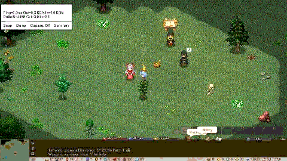

# Test report from the maintainer (in-game button, with the replay).

Issue: https://github.com/jeanfreger/elin-together-independence/issues/18  
Version: 0.26.1091.38155



## What happened

Test report from the maintainer (in-game button, with the replay).
This one shows what a report from a player looks like: the page, the replay and the logs.

## The game

```
Elin Together 0.26.1091.38155
Elin EA 23.356 Patch 1
Player (Steam): Elin Together
Written 2026-10-27 21:20:51 (local), 20:20:51 UTC
Role: ElinNetClient, away: False, guest: False
Players: 2
Zone: startSite #7, date raw 251657773
Party of 474: count 1, leader 1, own slots 0
  1 chara: owner 0, player False, dead False, zone startSite, slots 1
  474 chara: owner 0, player True, dead False, zone startSite, slots 1
Mods: elin_core1, elin.plugins.modding, elin_language_chinese, elin_minigame_slot, jp.cmbc.mod.elin.yk-framework, android_specific_portraits_settings, dk.elinplugins.elintogether, maccha_coffee_somewhat_enhanced_display, zawmbie.dynamic.riding, adv_portrait_naruse6, tp_stackable_spellbook, UN_adv_portrait_naruse
```

## Files

- [replay.gif](replay.gif): the last 30 seconds of the screen (also below)
- [Player.log](Player.log): the game's log (its last part)
- [ElinTogether.log](ElinTogether.log): the mod's log (its last part)
- [report.zip](report.zip): everything: all the logs and the 30 pictures